

  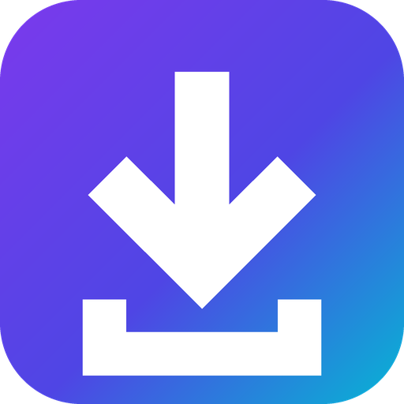

<h1 align="center">MegaDL</h1>

<b>Download manager for Android and Windows</b> 
Music as Opus or MP3 with cover art and lyrics · video at your quality with subtitles · fast direct files with pause and resume · phone and PC pairing · browser extension

  <a href="https://github.com/MegaMind2999/MegaDLAPK/releases/latest/download/MegaDL.apk"><b>⬇ Android</b></a>
  &nbsp;·&nbsp;
  <a href="https://github.com/MegaMind2999/MegaDLAPK/releases/latest/download/MegaDL-Setup.exe"><b>⬇ Windows</b></a>
  &nbsp;·&nbsp;
  <a href="https://github.com/MegaMind2999/MegaDLAPK/releases/latest/download/MegaDL-extension.zip"><b>⬇ Browser extension</b></a>
   
  <a href="https://github.com/MegaMind2999/MegaDLAPK/releases/latest">Release notes</a>
  &nbsp;·&nbsp;
  <a href="https://megamind2999.github.io/MegaDLAPK/">Website</a>

Free · No ads · No tracking · Android 7.0+ · Windows 10/11 x64

---

## What is MegaDL?

MegaDL is a download manager in the spirit of IDM, for Android and Windows. Share a link from any app, whether it's YouTube, SoundCloud, any other site yt-dlp supports or a direct file, or paste several links at once. Music arrives as Opus or MP3 with cover art, metadata and, if you like, synced lyrics. Videos come at the quality you pick, with English or Arabic subtitles. Direct files download over several connections at once, with pause and resume.

Your phone and PC pair over Wi-Fi so you can send a download from one to the other, and the browser extension hands downloads from Chrome, Brave and Edge to MegaDL on your PC. Everything stays on your devices and your own network.

  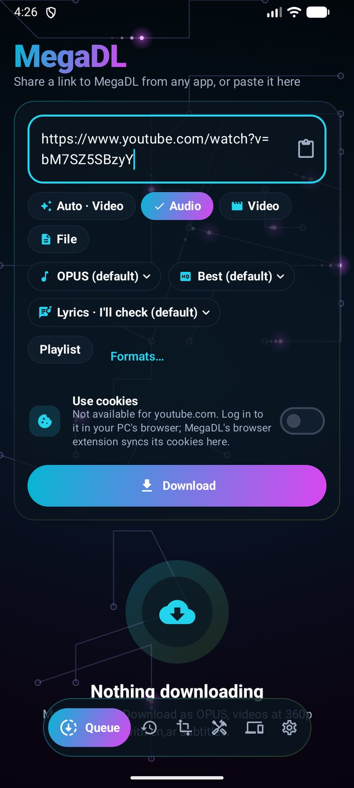
  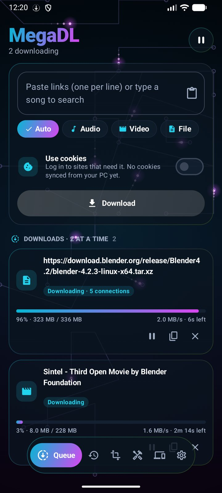
  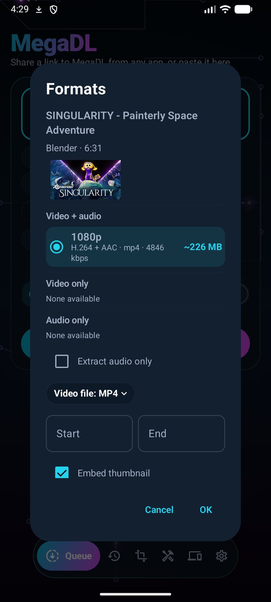
  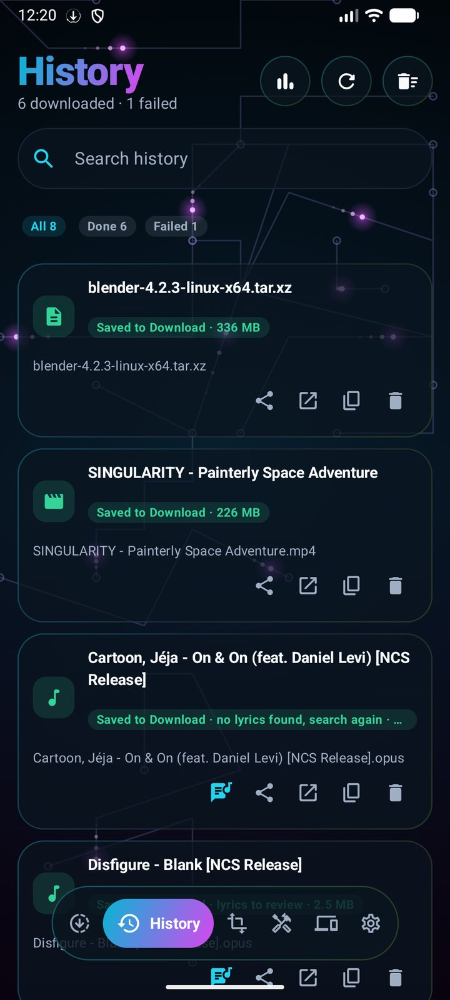
  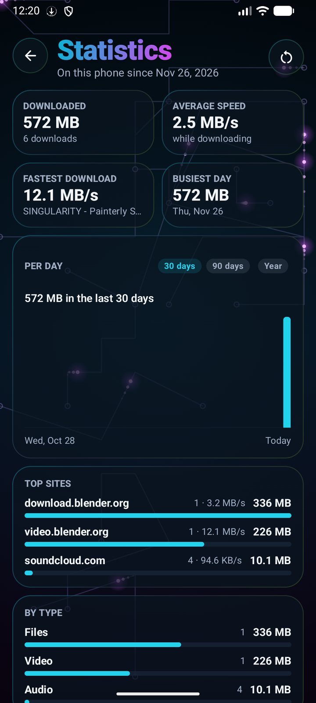
  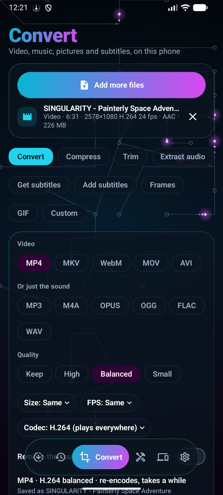
  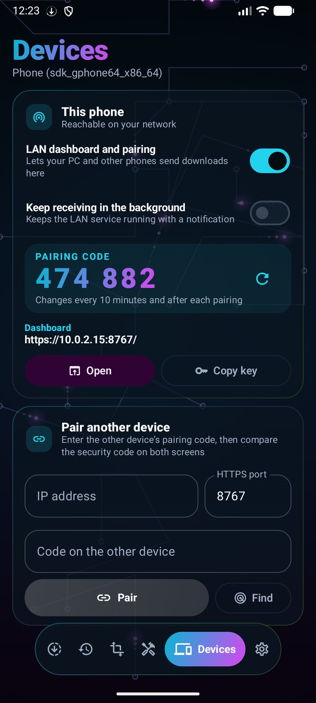
  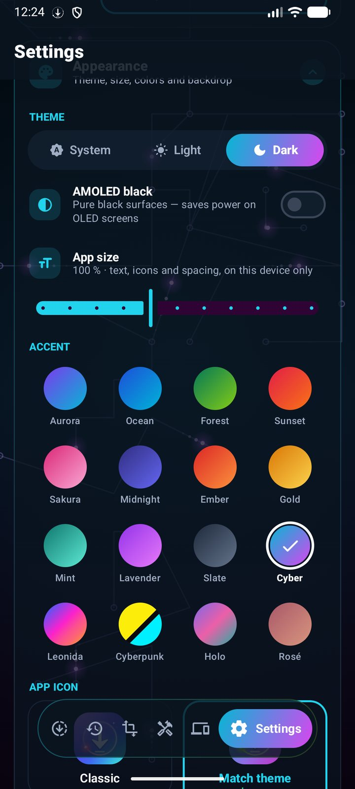

  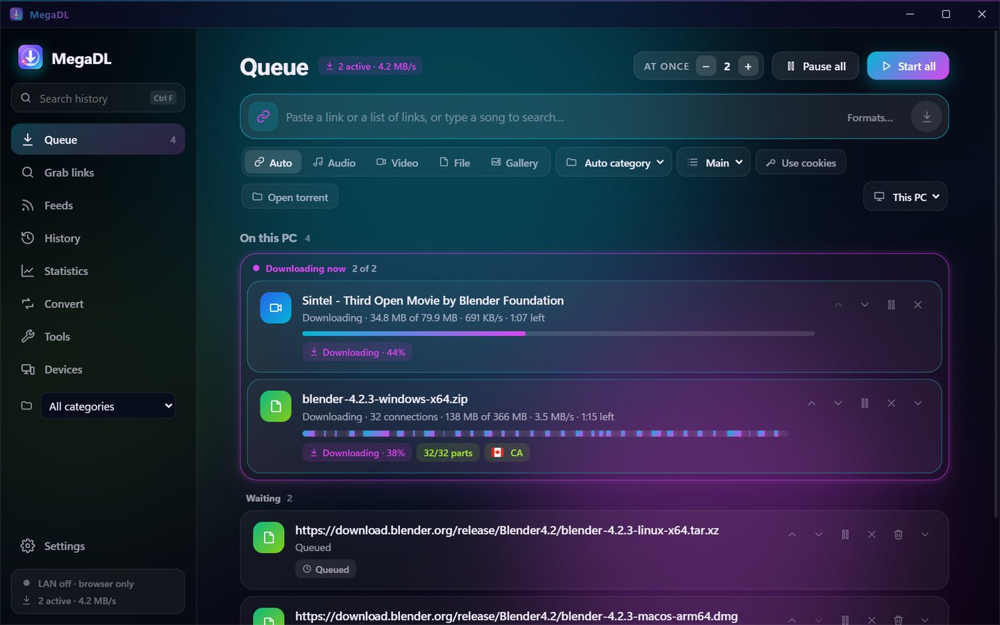

## Features

**Downloads**
- Share a link from any app: YouTube, SoundCloud, any yt-dlp site, or a direct file
- Paste several links at once, or type a song name to search
- Direct files over multiple connections at once, with pause and resume

**Music and video**
- Music as Opus or MP3, in best quality or small size
- Cover art and metadata, plus optional synced lyrics from LRCLIB
- Video at a chosen quality (1080p, 720p…) with English or Arabic subtitles

**Queue**
- Several downloads at a time, with live speed and time left
- Wi-Fi-only option and retry
- History with search and filters, and statistics: total, speeds, busiest day, top sites and types

**Convert and tools**
- Convert videos and music, compress, trim, pull the sound out, make a GIF, save frames, take subtitles out and put them back
- Edit music tags and covers for one song or many, add synced lyrics to songs you already have

**Phone and PC**
- Pair your phone and PC on the same Wi-Fi from the Devices screen
- Send a download from one device to the other; jobs for an offline device wait until it's back on your network
- Either app serves a browser dashboard on your network, protected by a key

**Windows**
- Grab links from a whole page, RSS feeds, image galleries, torrents and magnet links
- Scheduler with start and stop times and days
- When done: do nothing, exit, sleep or shut down, with a 60-second cancel
- Start all / Pause all
- Finds yt-dlp and FFmpeg if they're already installed (as programs or through Python), or installs its own

**Browser extension (Chrome, Brave, Edge)**
- Catches downloads and hands them to MegaDL with the page's cookies and referer, so login-only files work
- Alt+click a link to send it to MegaDL
- The popup lists the media on the page
- If MegaDL isn't running, the browser just downloads normally

**Everything else**
- A default folder for each type, a proxy, parallel downloads and connections per file
- Themes and accent colours, light, dark and AMOLED, a glass navigation bar and collapsible settings groups
- Updates itself from GitHub: Android checks daily (Settings → Updates); Windows checks every 12 hours, installs quietly and keeps your settings
- Light in the background: on Windows, minimized or in the tray MegaDL stops drawing and polling and its background pauses when it isn't the active window; on Android the background stops off screen and in battery saver, and the phone is only kept awake while something downloads
- Easy on your disk: download progress is saved every 30 seconds instead of rewriting the whole list every 2 seconds, and nothing is written when nothing changed
- Private: no accounts, ads, analytics or developer servers

## Install

**Android**

1. Download [**MegaDL.apk**](https://github.com/MegaMind2999/MegaDLAPK/releases/latest/download/MegaDL.apk) on your phone.
2. Open it and, if Android asks, allow installing apps from your browser or file manager. If you use Termux, MegaDL also asks for permission to run commands in it.
3. Music and video downloads use the yt-dlp and FFmpeg in Termux if you have them; otherwise MegaDL downloads its own engine once (about 50 MB). To update, let MegaDL do it, or install the newer APK over the old one.

**Windows**

1. Download [**MegaDL-Setup.exe**](https://github.com/MegaMind2999/MegaDLAPK/releases/latest/download/MegaDL-Setup.exe) (Windows 10/11 x64).
2. Run it and choose to install for just you or for all users, and pick the folder.
3. MegaDL uses the yt-dlp and FFmpeg you already have, or installs its own. It updates itself.

**Browser extension (Chrome, Brave, Edge)**

1. Download [**MegaDL-extension.zip**](https://github.com/MegaMind2999/MegaDLAPK/releases/latest/download/MegaDL-extension.zip) and unzip it, or open MegaDL for Windows → **Settings → Browser**, which shows the extension folder and the pairing key.
2. Open `chrome://extensions`, turn on **Developer mode**, choose **Load unpacked** and pick the extension folder.
3. Downloads now go to MegaDL. If MegaDL isn't running, the browser downloads normally.

## Pair your phone and PC

Put both on the same Wi-Fi and open the **Devices** screen to pair them. Then you can send a download from one device to the other. If the other device is offline, the job waits until it's back on your network. Nothing goes through the internet or any server.

## Privacy and terms

- [Privacy Policy](https://megamind2999.github.io/MegaDLAPK/privacy.html)
- [Terms of Use](https://megamind2999.github.io/MegaDLAPK/terms.html)

You are responsible for downloading only content you have the right to download.

## More from MegaMind

<a href="https://megamind2999.github.io/MegaShareApk/">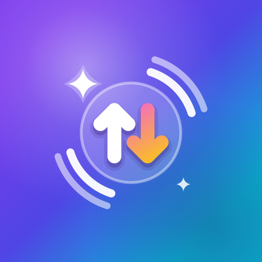</a>
**[MegaShare](https://megamind2999.github.io/MegaShareApk/)**: share files and apps from Android with any phone or computer over Wi-Fi or hotspot. They only need a browser: no app, no internet, no account. Watch party included.
 

<a href="https://megamind2999.github.io/MegaDoApk/">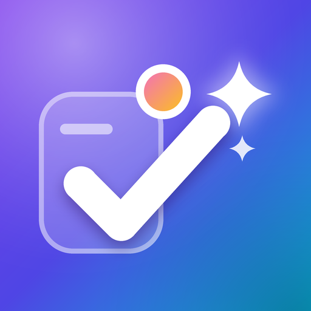</a>
**[MegaDo](https://megamind2999.github.io/MegaDoApk/)**: to-do list, notes and reminders for Android and Windows, with alarms, location reminders, 77 handy tools and sync through your own Google Drive.
 

## Feedback

Found a bug or have an idea? [Open an issue](https://github.com/MegaMind2999/MegaDLAPK/issues).

---

© 2026 MegaMind. All rights reserved. MegaDL is free for personal use; see the [Terms of Use](terms.html).
